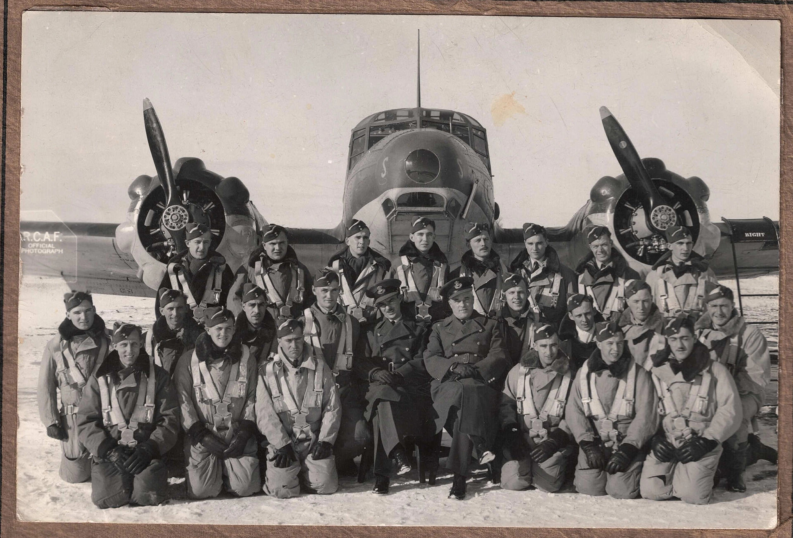

# London Aviation Museum

## Table of Content:
- [Description](#description)
- [Languages](#languages)
- [Tools](#tools)
- [History](#history)
- [Credits](#credits)
- [License](#license)

## Description:
This Project if for teams of students to design, develop, and pitch a professional marketing and advertising campaign and website for their Final Integrated Project London Aviation Museum.

## Languages:
HTML5, CSS3, SASS, Javascript, PHP, mySQL

## Tools:
Github, Git, Figma, Visual Studio, Creative Adobe Suite,  
Cinema 4D, Microsoft 365, GSAP, WAMP

## History:
2026 - Present

## Credits:
Zakia Sultana, Tapshveer Benipal, Aayush Diyali, Andrea Do, Ajay Chakaravarthy Anthony Raj, Luciano Clementi 

## License:
MIT License